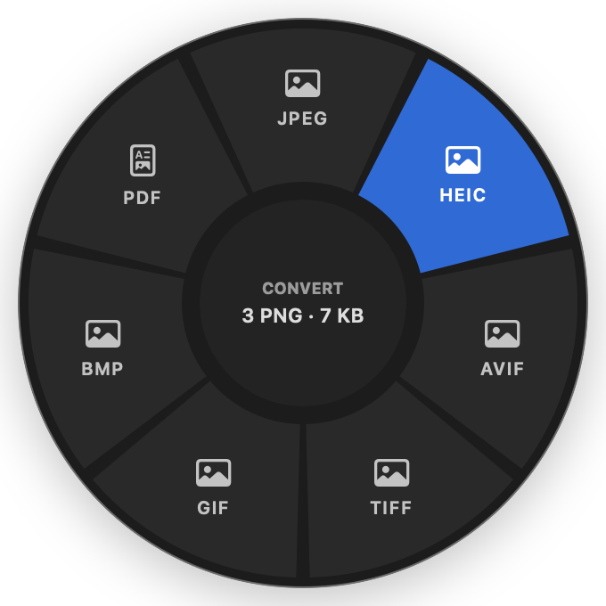
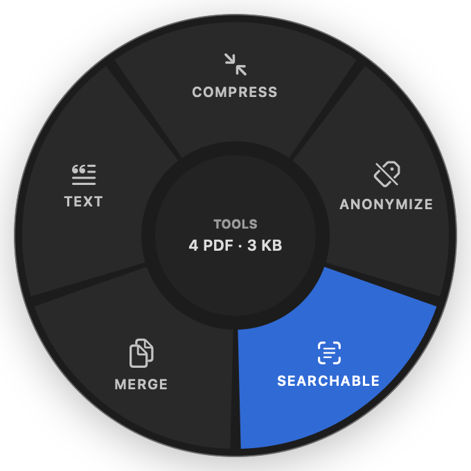
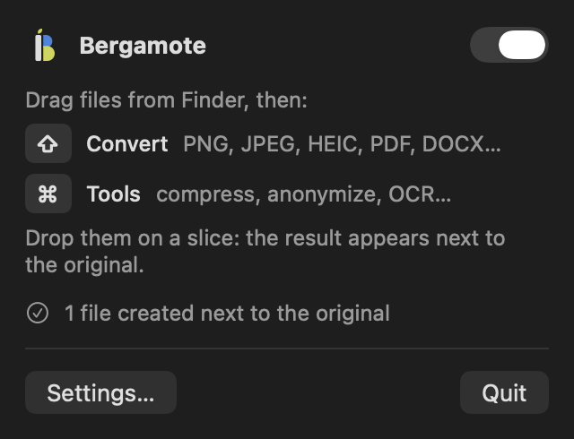
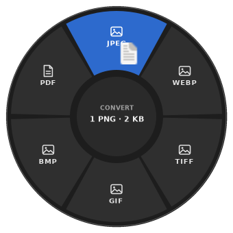

<p align="center">
  
</p>

<h1 align="center">Bergamote</h1>

<p align="center">
  
</p>

<p align="center">
  
  
  
  
  
  
  
</p>

<p align="center"><b>Drag a file. Tap ⇧. Drop it on a slice.</b><br>A radial file converter that lives in your menu bar, on macOS, Windows and Linux.</p>

<p align="center">
  <a href="https://loanallard.github.io/Bergamote/">Website</a> ·
  <a href="https://github.com/LoanALLARD/Bergamote/releases/latest">Download</a> ·
  <a href="#download-and-install">Install</a>
</p>

---

You have a scan to send as a PDF, an iPhone photo that has to be a JPEG, a contract whose author
and location data you would rather not share. Each of these means opening an app, hunting through
menus, exporting, renaming, and hoping nothing went to the cloud along the way.

**Bergamote** puts all of it under your cursor. Start dragging any file, tap a modifier key, and a
wheel of actions opens right where you are: convert, compress, anonymize, make searchable. Drop the
file on a slice and the result appears **next to the original**, in the same folder. There is no
window to manage and no Dock icon: Bergamote runs quietly in the menu bar, the Windows notification
area or the Linux tray. The interface is available in **English and French**.

Nothing leaves your computer. On the Mac, the app is sandboxed **without any network
entitlement**, so this is enforced by macOS, not just promised. Windows and Linux versions, built on the
same core, are in preview.

## What it looks like

<p align="center">
  
  &nbsp;&nbsp;
  
</p>

<p align="center"><sub>The conversion wheel (⇧) for three PNG files, and the tools wheel (⌘) for four PDFs.</sub></p>

<p align="center">
  
</p>

<p align="center"><sub>The menu bar panel: a reminder of the gesture, the last result, settings.</sub></p>

<p align="center">
  
</p>

<p align="center"><sub>The same wheel on Linux, as a PNG file is dropped on the JPEG slice.</sub></p>

## Features

- 🎯 **Radial menu anywhere.** Drag files from Finder or any app, tap ⇧ or ⌘ (or hold it before you start dragging), drop on a slice.
- 🔄 **Conversions.** Images to PNG, JPEG, HEIC, AVIF, TIFF, GIF, BMP or PDF; PDF pages to images; Word, RTF and text to PDF and back.
- 🗜 **Compression.** Photos resized and re-encoded, PDF images optimized; nothing is written if there is nothing to gain.
- 🕶 **Anonymization.** Strips EXIF, GPS location and camera data from photos, author and title from PDFs, while keeping photos the right way up.
- 🔎 **Searchable PDFs and text.** Adds an invisible OCR text layer to scans, or extracts the text of any document, with Apple's on-device Vision OCR.
- 📁 **Results stay where you work.** Output is written next to the original, never over it (`photo 2.jpeg` if needed), without opening Finder.
- 🪶 **Menu bar only.** No window, no Dock icon. A soft click marks each slice as you move across the wheel.
- 🚀 **Starts with your computer** if you turn it on in Settings.
- 🌍 **English and French.** Follows the system language, or the one you choose in Settings, without restarting.
- 🔒 **Private by design.** No account, no network access, no telemetry.

## The wheel

The slices adapt to the files you drag. A format macOS cannot write on your system is not offered.

| Wheel | Files | Slices |
|---|---|---|
| **Convert** (⇧) | Images | PNG · JPEG · HEIC · AVIF · TIFF · GIF · BMP · PDF |
| | PDF | Pages as PNG / JPEG / HEIC · TXT |
| | Word, RTF, text | PDF · DOCX · RTF · TXT |
| | Images and PDFs together | PDF (merged) · TXT |
| **Tools** (⌘) | Images, PDF | Compress · Anonymize · Searchable · Merge · Text |
| | Word, RTF, text | Text |

Keys can be changed in **Settings**, where you can also turn the click sound on or off.

### What each system can do

The slices come from the shared core; each app tells it what its system can convert, and the
slices it could not run are not offered.

| | macOS | Windows | Linux |
|---|---|---|---|
| Convert key / tools key | ⇧ / ⌘ | Shift / Ctrl | Shift / Ctrl |
| Images written | PNG, JPEG, HEIC, AVIF, TIFF, GIF, BMP | PNG, JPEG, TIFF, GIF, BMP | PNG, JPEG, WebP, TIFF, GIF, BMP |
| PDF pages to images | ✓ | ✓ | ✓ |
| Images and PDFs to one PDF | ✓ | ✓ | ✓ |
| Compress | images, PDF | images | images |
| Anonymize | images, PDF | images, PDF | images, PDF |
| Text from PDF and Office files | ✓ | ✓ | ✓ |
| Text from images (OCR) | Vision | Windows OCR | Tesseract, if installed |
| Searchable PDF | ✓ | | with Tesseract |
| Word, RTF, text to PDF and back | ✓ | | |

On Windows, HEIC, WebP and AVIF files can be read when their Microsoft Store image extensions are
installed.

## Download and install

**Requirements:** macOS 14 Sonoma or later, on Apple silicon or Intel; Windows 10 (1809) or later,
x64; or a Linux desktop with GTK 4 and an X11 session.

### Mac, from a release

1. Download the latest `Bergamote-x.y.z.zip` from the [Releases](https://github.com/LoanALLARD/Bergamote/releases/latest) page.
2. Unzip it and move **Bergamote.app** to your **Applications** folder.
3. Open it. Release builds are not notarized yet, so the first time macOS may refuse to open the
   app: right-click it and choose **Open**, or go to **System Settings › Privacy & Security** and
   click **Open Anyway**.
4. The Bergamote icon appears in the menu bar. The first time the wheel saves a result, macOS asks you to
   allow a folder: choose your **home folder** once and every folder inside it is covered. You can
   revoke it in Settings.

To start Bergamote with your Mac, turn on **Start Bergamote at login** in Settings.

### Windows (preview)

Each build of the `main` branch produces a self-contained `Bergamote.exe` (no .NET install needed),
available from the **Bergamote-windows-x64** artifact of the latest
[CI run](https://github.com/LoanALLARD/Bergamote/actions/workflows/ci.yml). Run it: the Bergamote icon
appears in the notification area. The executable is not signed yet, so SmartScreen may ask you to
confirm with **More info › Run anyway**. Starting with Windows can be turned on in Settings.

### Linux (preview)

Each build of the `main` branch produces a `.deb` (Debian, Ubuntu 24.04 and later, Mint…) and a
`.tar.gz` for other distributions, in the **Bergamote-linux** artifact of the latest
[CI run](https://github.com/LoanALLARD/Bergamote/actions/workflows/ci.yml).

```bash
sudo apt install ./bergamote_1.0.0_amd64.deb     # Debian and Ubuntu
```

```bash
tar xzf bergamote-1.0.0-linux-x86_64.tar.gz && bergamote-1.0.0-linux-x86_64/install.sh   # elsewhere, into ~/.local
```

Launch **Bergamote** from your applications menu: its settings open, and its icon appears in the
tray on desktops that have one (KDE, Xfce, Cinnamon, GNOME with the AppIndicator extension).
Launching it again reopens the settings.

- **X11 only for now.** Wayland does not let an app watch the pointer globally, so the gesture
  needs an X11 session (choose "Xorg" on the login screen). The settings window says so when it
  detects Wayland.
- **OCR is optional.** Install `tesseract-ocr` (and `tesseract-ocr-fra` for French) to get text
  from images and searchable PDFs; without it those slices are not offered.

### From source

All three apps need [Rust](https://rustup.rs) to build the shared core.

**Mac** (Xcode 16 or later):

```bash
git clone https://github.com/LoanALLARD/Bergamote.git
cd Bergamote
rustup target add aarch64-apple-darwin x86_64-apple-darwin
mac/scripts/make-app.sh      # builds the core, then mac/build/Bergamote.app (sandboxed, ad hoc signed)
open mac/build/Bergamote.app
```

For development, `swift run --package-path mac Bergamote` runs the app outside the sandbox, and
`mac/Package.swift` opens directly in Xcode. Run `mac/scripts/build-core.sh` again after changing
the core.

**Windows** (.NET 8 SDK):

```powershell
git clone https://github.com/LoanALLARD/Bergamote.git
cd Bergamote
dotnet run --project windows/Bergamote.Windows   # cargo builds the core automatically
```

**Linux** (GTK 4 development files, `libgtk-4-dev` on Debian and Ubuntu):

```bash
git clone https://github.com/LoanALLARD/Bergamote.git
cd Bergamote
cargo run --release --manifest-path linux/Cargo.toml
```

## Quick start

1. Launch Bergamote. Its icon appears in the menu bar (the notification area on Windows, the tray on Linux).
2. In Finder, Explorer or your file manager, start dragging an image or a PDF and keep the mouse button down.
3. Tap **⇧** for the conversion wheel, or **⌘** (**Ctrl** on Windows and Linux) for the tools wheel. You can also hold the key before you start dragging.
4. Drop the file on a slice. The result appears next to the original.

## How it works

```
core/      Rust: gesture state machine, wheel geometry, slice catalog, file naming,
           every text in English and French, click sound. C ABI in core/include.
mac/       Swift 6 menu bar app. Links the core as an XCFramework; conversions with
           ImageIO, PDFKit, CoreText and Vision.
windows/   C# / .NET 8 notification-area app (WPF). Calls the core with P/Invoke;
           conversions with WIC, Windows.Data.Pdf, Windows OCR, PDFsharp and PdfPig.
linux/     Rust app (GTK 4, X11) that uses the core as a crate; conversions in pure
           Rust (image, lopdf, hayro, pdf-extract), OCR through Tesseract.
docs/      The website.
```

[SPEC.md](SPEC.md) is the working specification of the three apps.

- **One behaviour, three native apps.** Everything that decides *what* the wheel does lives in the
  shared core, so the apps open on the same gesture, offer the same slices, name files the same
  way, speak the same two languages and play the same click. Each app declares what its platform can convert, and the core
  hides the slices it could not run. File conversion itself stays native on each system.
- **Gesture detection.** A small state machine watches the mouse button, the drag and the
  modifier keys 20 times per second: the drag pasteboard on the Mac, the system drag threshold on
  Windows and Linux. On the Mac, App Nap is disabled while it runs so that detection stays instant when
  Bergamote is in the background. On Windows and Linux, the wheel opens invisible under the cursor
  and only appears once the drag brings files over it, so dragging text or a window never shows it.
- **Sandbox-friendly file access.** Dropping files on the wheel grants the sandboxed app access to
  exactly those files. Writing the result next to them needs one folder permission, asked once and
  stored as a security-scoped bookmark.
- **System frameworks only.** Conversions use ImageIO, PDFKit, CoreText and AppKit, and OCR uses
  Vision: no bundled converters, no external services, a small universal binary.

## Privacy

On the Mac, Bergamote has no network entitlement: macOS blocks every connection, whatever the code
does. The Windows and Linux apps are not sandboxed, but make no network connection either. The
only files it writes are the results you ask for, next to their originals. Its settings, including
folder permissions, live in `~/Library/Containers/com.example.bergamote/` and can be reviewed and
revoked in Settings.

## Development

```bash
cargo test --manifest-path core/Cargo.toml                       # shared core
swift test --package-path mac                                    # Mac: gesture, catalog and conversion tests
dotnet test windows/Bergamote.Core.Tests                         # .NET wrapper of the core (runs on Mac too)
dotnet test windows/Bergamote.sln                                # everything Windows, on Windows
cargo test --manifest-path linux/Cargo.toml                      # Linux conversions (pure Rust, run anywhere)
linux/scripts/docker.sh scripts/smoke-test.sh                    # Linux app: real drags and drops under Xvfb, in Docker
pwsh -File windows/scripts/smoke-test.ps1                        # Windows app: a real drag and drop, on Windows
```

Mac extras, from the `mac/` folder:

```bash
BERGAMOTE_SNAPSHOT_DIR=build/snapshots swift test     # also renders the wheels and the menu bar panel
swift scripts/make-samples.swift SampleDocs           # fictitious PDFs, scan, image, .docx and .txt to try
scripts/package-release.sh                            # universal .zip for GitHub Releases
```

[CI](.github/workflows/ci.yml) runs on every push: core tests and lint, then build, tests and
package for each app. The Windows and Linux jobs also drive the packaged app like a person would:
drag a file, tap the key, drop it on a slice, and check the converted file. Pushing a `v*` tag runs
[release.yml](.github/workflows/release.yml), which publishes the three packages as a GitHub
release.

The website is a single static page in [`docs/`](docs/), published with GitHub Pages from the
`main` branch. Preview it locally with `python3 -m http.server --directory docs`.

To debug the gesture on the Mac, launch with `open mac/build/Bergamote.app --args -wheel.debug YES` and follow
`/usr/bin/log stream --predicate 'subsystem == "com.example.bergamote"'`. With
`-wheel.demo conversion`, the wheel opens on its own after two seconds to test the display.

## Roadmap

- Notarized, signed releases, and a signed Windows installer
- Option panels for tools (compression level, output format)
- PDF compression on Windows and Linux, searchable PDFs on Windows
- A gesture that works under Wayland

## License

No license has been chosen yet. Until one is added, all rights are reserved by the author.
