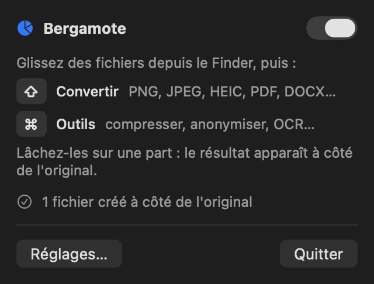

<p align="center">
  
</p>

<p align="center">
  
  
  
  
  
</p>

<p align="center"><b>Drag a file. Tap ⇧. Drop it on a slice.</b><br>A radial file converter that lives in your macOS menu bar.</p>

---

You have a scan to send as a PDF, an iPhone photo that has to be a JPEG, a contract whose author
and location data you would rather not share. Each of these means opening an app, hunting through
menus, exporting, renaming, and hoping nothing went to the cloud along the way.

**Bergamote** puts all of it under your cursor. Start dragging any file, tap a modifier key, and a
wheel of actions opens right where you are: convert, compress, anonymize, make searchable. Drop the
file on a slice and the result appears **next to the original**, in the same folder. There is no
window to manage and no Dock icon: Bergamote runs quietly in the menu bar.

Nothing leaves your Mac. The app is sandboxed **without any network entitlement**, so this is
enforced by macOS, not just promised.

## What it looks like

<p align="center">
  
  &nbsp;&nbsp;
  
</p>

<p align="center"><sub>The conversion wheel (⇧) for three PNG files, and the tools wheel (⌘) for four PDFs.</sub></p>

<p align="center">
  
</p>

<p align="center"><sub>The menu bar panel: a reminder of the gesture, the last result, settings.</sub></p>

## Features

- 🎯 **Radial menu anywhere.** Drag files from Finder or any app, tap ⇧ or ⌘ (or hold it before you start dragging), drop on a slice.
- 🔄 **Conversions.** Images to PNG, JPEG, HEIC, AVIF, TIFF, GIF, BMP or PDF; PDF pages to images; Word, RTF and text to PDF and back.
- 🗜 **Compression.** Photos resized and re-encoded, PDF images optimized; nothing is written if there is nothing to gain.
- 🕶 **Anonymization.** Strips EXIF, GPS location and camera data from photos, author and title from PDFs, while keeping photos the right way up.
- 🔎 **Searchable PDFs and text.** Adds an invisible OCR text layer to scans, or extracts the text of any document, with Apple's on-device Vision OCR.
- 📁 **Results stay where you work.** Output is written next to the original, never over it (`photo 2.jpeg` if needed), without opening Finder.
- 🪶 **Menu bar only.** No window, no Dock icon. A soft click marks each slice as you move across the wheel.
- 🔒 **Private by design.** No account, no network access, no telemetry.

## The wheel

The slices adapt to the files you drag. A format macOS cannot write on your system is not offered.

| Wheel | Files | Slices |
|---|---|---|
| **Convert** (⇧) | Images | PNG · JPEG · HEIC · AVIF · TIFF · GIF · BMP · PDF |
| | PDF | Pages as PNG / JPEG / HEIC · TXT |
| | Word, RTF, text | PDF · DOCX · RTF · TXT |
| | Images and PDFs together | PDF (merged) · TXT |
| **Tools** (⌘) | Images, PDF | Compress · Anonymize · Searchable · Merge · Text |
| | Word, RTF, text | Text |

Keys can be changed in **Settings**, where you can also turn the click sound on or off.

## Download and install

**Requirements:** macOS 14 Sonoma or later, on Apple silicon or Intel. The interface is currently in French.

### From a release

1. Download the latest `Bergamote-x.y.z.zip` from the [Releases](https://github.com/LoanALLARD/Bergamote/releases/latest) page.
2. Unzip it and move **Bergamote.app** to your **Applications** folder.
3. Open it. Release builds are not notarized yet, so the first time macOS may refuse to open the
   app: right-click it and choose **Open**, or go to **System Settings › Privacy & Security** and
   click **Open Anyway**.
4. A pie icon appears in the menu bar. The first time the wheel saves a result, macOS asks you to
   allow a folder: choose your **home folder** once and every folder inside it is covered. You can
   revoke it in Settings.

To start Bergamote with your Mac, add it in **System Settings › General › Login Items**.

### From source

Requires Xcode 16 or later.

```bash
git clone https://github.com/LoanALLARD/Bergamote.git
cd Bergamote
scripts/make-app.sh          # builds build/Bergamote.app (release, sandboxed, ad hoc signed)
open build/Bergamote.app
```

For development, `swift run Bergamote` runs the app outside the sandbox, and `Package.swift` opens
directly in Xcode.

## Quick start

1. Launch Bergamote. Its pie icon appears in the menu bar.
2. In Finder, start dragging an image or a PDF and keep the mouse button down.
3. Tap **⇧** for the conversion wheel or **⌘** for the tools wheel. You can also hold the key before you start dragging.
4. Drop the file on a slice. The result appears next to the original.

## How it works

- **Gesture detection.** A small state machine watches the mouse button, the drag pasteboard and
  the modifier keys 20 times per second. App Nap is disabled while it runs so that detection stays
  instant when Bergamote is in the background.
- **Sandbox-friendly file access.** Dropping files on the wheel grants the sandboxed app access to
  exactly those files. Writing the result next to them needs one folder permission, asked once and
  stored as a security-scoped bookmark.
- **System frameworks only.** Conversions use ImageIO, PDFKit, CoreText and AppKit, and OCR uses
  Vision: no bundled converters, no external services, a small universal binary.

## Privacy

Bergamote has no network entitlement: macOS blocks every connection, whatever the code does. The
only files it writes are the results you ask for, next to their originals. Its settings, including
folder permissions, live in `~/Library/Containers/com.example.bergamote/` and can be reviewed and
revoked in Settings.

## Development

```bash
swift test                                            # gesture, catalog and conversion tests
BERGAMOTE_SNAPSHOT_DIR=build/snapshots swift test     # also renders the wheels and the menu bar panel
swift scripts/make-samples.swift SampleDocs           # fictitious PDFs, scan, image, .docx and .txt to try
scripts/package-release.sh                            # universal .zip for GitHub Releases
```

To debug the gesture, launch with `open build/Bergamote.app --args -wheel.debug YES` and follow
`/usr/bin/log stream --predicate 'subsystem == "com.example.bergamote"'`. With
`-wheel.demo conversion`, the wheel opens on its own after two seconds to test the display.

## Roadmap

- Notarized, signed releases
- Option panels for tools (compression level, output format)
- Start at login from Settings
- English interface

## License

No license has been chosen yet. Until one is added, all rights are reserved by the author.
