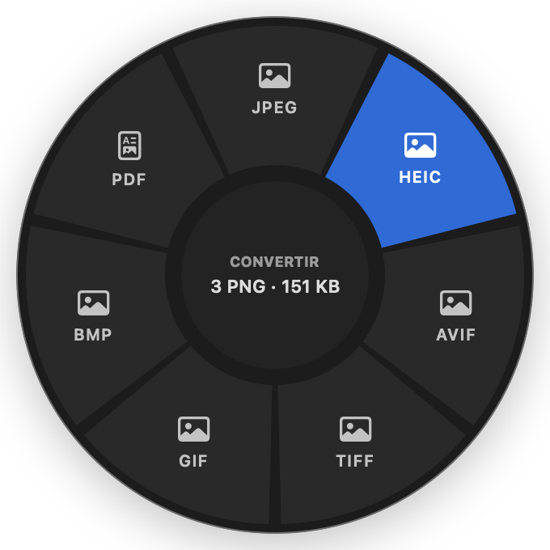
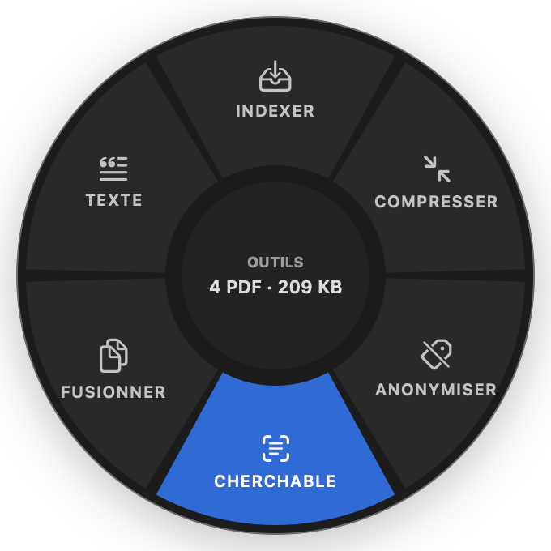

<p align="center">
  
</p>

<p align="center">
  
  
  
  
</p>

<p align="center"><b>Drag a file. Tap ⇧. Drop it on a slice.</b><br>A private, offline document manager for macOS, with a radial menu for instant conversions.</p>

---

You have a scan to send as a PDF, an iPhone photo that has to be a JPEG, a contract you need to find
again in a folder of two hundred files. Each of these means opening an app, hunting through menus,
exporting, renaming, and hoping nothing went to the cloud along the way.

**Bergamote** puts all of it under your cursor. Start dragging any file, tap a modifier key, and a
wheel of actions opens right where you are: convert, compress, anonymize, make searchable. Drop the
file on a slice and the result appears **next to the original**, in the same folder. Every document
you keep is also indexed in a local library you can search by words, read with OCR, and that sorts
itself into invoices, payslips, contracts and more.

Nothing leaves your Mac. The app is sandboxed **without any network entitlement**, so this is
enforced by macOS, not just promised.

## What it looks like

<p align="center">
  
  &nbsp;&nbsp;
  
</p>

<p align="center"><sub>Left: the conversion wheel (⇧) for three PNG files. Right: the tools wheel (⌘) for four PDFs.</sub></p>

## Features

- 🎯 **Radial menu anywhere.** Drag files from Finder or any app, tap ⇧ or ⌘ (or hold it before you start dragging), drop on a slice.
- 🔄 **Conversions.** Images to PNG, JPEG, HEIC, AVIF, TIFF, GIF, BMP or PDF; PDF pages to images; Word, RTF and text to PDF and back.
- 🧰 **Tools.** Compress, strip metadata (EXIF, GPS location, author), add a searchable OCR text layer, merge into one PDF, extract text.
- 📁 **Results stay where you work.** Output is written next to the original, never over it (`photo 2.jpeg` if needed), without opening Finder.
- 🔎 **Search your documents.** French-aware full-text search (lemmatized, accent-insensitive) with matching words highlighted in the PDF preview, plus a ⌘K palette.
- 👁 **OCR built in.** Scanned PDFs and photos of documents are read with Apple's Vision framework, on device.
- 🏷 **Automatic sorting.** Invoices, quotes, contracts, payslips, tax notices, bank statements and more, learning from each correction you make.
- 🧾 **Validated fields.** IBAN (mod 97), SIRET/SIREN (Luhn), amounts, dates, e-mails and phone numbers, checked rather than guessed.
- 🔒 **Private by design.** No account, no network access, no telemetry. One local SQLite file holds the whole index.

## The wheel

The slices adapt to the files you drag. A format macOS cannot write on your system is not offered.

| Wheel | Files | Slices |
|---|---|---|
| **Convert** (⇧) | Images | PNG · JPEG · HEIC · AVIF · TIFF · GIF · BMP · PDF |
| | PDF | Pages as PNG / JPEG / HEIC · TXT |
| | Word, RTF, text | PDF · DOCX · RTF · TXT |
| **Tools** (⌘) | Images, PDF | Index · Compress · Anonymize · Searchable · Merge · Text |
| | Other documents | Index · Text |

Keys can be changed in **Settings** (⌘,), where you can also turn the hover click sound on or off.

## Download and install

**Requirements:** macOS 14 Sonoma or later. The interface is currently in French.

### From a release

1. Download the latest `Bergamote-x.y.z.zip` from the [Releases](../../releases/latest) page.
2. Unzip it and move **Bergamote.app** to your **Applications** folder.
3. Open it. Release builds are not notarized yet, so the first time macOS may refuse to open the
   app: right-click it and choose **Open**, or go to **System Settings › Privacy & Security** and
   click **Open Anyway**.
4. The first time the wheel saves a result, macOS asks you to allow a folder. Choose your **home
   folder** once: every folder inside it is then covered, and you can revoke it in Settings.

### From source

Requires Xcode 16 or later. Clone this repository, then:

```bash
cd Bergamote
scripts/make-app.sh          # builds build/Bergamote.app (release, sandboxed, ad hoc signed)
open build/Bergamote.app
```

For development, `swift run Bergamote` runs the app outside the sandbox, and `Package.swift` opens
directly in Xcode.

## Quick start

1. Launch Bergamote. Its icon appears in the menu bar; the library window is optional.
2. In Finder, start dragging an image or a PDF and keep the mouse button down.
3. Tap **⇧** for the conversion wheel or **⌘** for the tools wheel.
4. Drop the file on a slice. The result appears next to the original.

To build your library, drop documents (or whole folders) on the window or the menu bar icon, or use
**Index** in the tools wheel. Search with the toolbar field or **⌘K**; right-click a document for
**Convert…** and **Tools…**.

## How it works

- **One file, one index.** Metadata, full-text index (SQLite FTS5), vectors
  ([sqlite-vec](https://github.com/asg017/sqlite-vec), compiled into the app) and the job queue live
  in a single SQLite database, so every document is written atomically and a backup is one file.
- **Two-phase indexing.** Text is extracted first (PDFKit, or Vision OCR for scans) so a document is
  searchable within seconds; entities, vectors and classification follow in the background, paused
  in Low Power Mode or when the Mac runs hot.
- **Gesture detection.** A small state machine watches the mouse button, the drag pasteboard and the
  modifier keys at 20 Hz. Dropping on the wheel also grants the sandboxed app access to the dropped
  files, so no broad disk permission is needed.
- **System frameworks only.** Conversions use ImageIO, PDFKit, CoreText and AppKit: no bundled
  converters, no external services.
- **Semantic search, optional.** Out of the box, search is lexical. A CamemBERT sentence encoder can
  be converted to Core ML with `scripts/convert_camembert.py` and dropped into the app to add search
  by meaning; its tokenizer is reimplemented in Swift and checked against Hugging Face's.

## Privacy

Bergamote has no network entitlement: macOS blocks every connection, whatever the code does. Your
library lives in `~/Library/Containers/com.example.bergamote/` and the only files the app writes
elsewhere are the results you ask for, next to their originals. Folder permissions are listed in
Settings and can be revoked at any time.

## Development

```bash
swift test                                     # unit and end-to-end tests
swift scripts/make-samples.swift SampleDocs    # fictitious sample documents
BERGAMOTE_SAMPLES_DIR=SampleDocs BERGAMOTE_SNAPSHOT_DIR=build/snapshots swift test
scripts/package-release.sh                     # universal .zip for GitHub Releases
```

The second test run adds the sample-corpus quality checks and off-screen renders of every screen.
To debug the gesture, launch with `open build/Bergamote.app --args -wheel.debug YES` and follow
`/usr/bin/log stream --predicate 'subsystem == "com.example.bergamote"'`.

## Roadmap

- Notarized, signed releases
- Bundled CamemBERT model for search by meaning
- Extraction in an isolated XPC service
- Watched folders and an encrypted index
- English interface

## License

No license has been chosen yet. Until one is added, all rights are reserved by the author.
